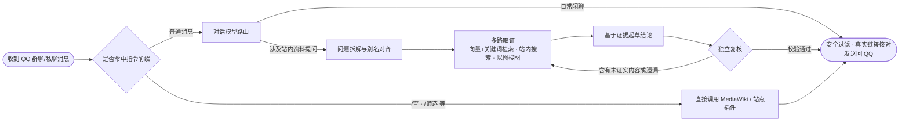

<div align="center">


<p>
  
  
  
  
  
</p>

<p>
  <a href="#项目简介">项目简介</a> ·
  <a href="#实际问答效果">问答效果</a> ·
  <a href="#快速开始">快速开始</a> ·
  <a href="#接入自己的-wiki-与编写插件">编写与同步插件</a> ·
  <a href="#web-管理后台">管理后台</a> ·
  <a href="docs/架构.md">系统架构</a> ·
  <a href="docs/插件规范.md">插件规范</a> ·
  <a href="docs/部署与运维.md">进阶运维</a>
</p>

</div>

## 项目简介

**JianShanAgent（见山）** 是一个面向 **MediaWiki** 站点的开源 **QQ 问答机器人框架**。它可以把任意 MediaWiki 站点的词条页面、结构化数据、公告剧情和图片构建为本地知识库，接入 QQ 官方机器人（支持群聊 `@` 与私聊），准确回答玩家或社群成员关于站内资料的提问。

做游戏或资料站的 Wiki 问答机器人，通常会卡在两个问题上：
- **纯指令机器人太死板**：只能按预设格式查固定词条，用户换种问法、用个圈内黑话或者直接发张截图就查不出来。
- **直接接大模型容易胡编**：模型经常记混不同版本的技能数值，还会凭空捏造根本不存在的 Wiki 链接。

见山通过“**指令直查 + 多步查证复核**”解决这两个问题，同时把核心框架做成与具体站点解耦的通用底座：

1. **指令直查（秒级响应、零幻觉）**：明确的查询指令（如 `/查 <词条或外号>`、`/筛选 <条件>`）直接读取 MediaWiki API 或站点插件提供的结构化数据，1～2 秒返回排版卡片，不消耗大模型 Token。
2. **多步查证问答（Agentic RAG + 独立复核）**：自然语言提问进入查证工作流，依次执行：**问题拆解与外号对齐 → 向量+关键词混合检索与站内实时搜索 → 基于证据起草结论 → 独立复核校验**。资料里没写的不允许脑补，复核不通过会打回补充检索；发出的所有词条链接都会与本轮实际查到的页面比对，杜绝假链接。
3. **Wiki 图库以图搜图**：使用图文同向量空间的嵌入模型（默认对接 `Qwen3-VL-Embedding-8B`）索引站内立绘、皮肤、头像与图标。用户在 QQ 发图提问时，先通过以图搜图定位角色或皮肤，再结合词条资料作答。
4. **每小时自动增量同步（`kbsync`）**：后台同步服务定时轮询 MediaWiki 的 `recentchanges` 接口，只重抓有变动的页面和受影响的数据集，增量算好向量热更新入库，无需停机；内置数据量暴跌与异常重算保护闸门。
5. **开箱即用的 Web 管理后台**：包内已内置编译好的 React 管理面板（免装 Node.js），支持逐条查看问答检索与复核全链路、免连 QQ 直接在网页对话调试、在线热更新配置与插件开关；主仓库发了新版本，后台里点一下就更新并重启，起不来自动退回。
6. **一个机器人挂多个 Wiki**：同一个题材有好几个 Wiki 时可以都挂上，各用各的站点插件。知识库各建各的、一起检索，`/查` 每个都查，回答和参考资料里标明出自哪个 Wiki。
7. **做好了的站点一键添加**：灰机、BWiki 这些 Wiki 平台的接口核心自带；已经有人做好站点插件的站列在[站点目录](https://github.com/JianShanAgent/catalog)里，在管理后台按平台筛选、点一下就下载并挂上，不用改配置、不用重启，再点一下开始建知识库。
8. **灵活部署与插件扩展**：既支持 **Python / `uv` 原生直跑**（不需要 Docker），也支持 **`docker compose up -d` 一键启动**，还提供面向生产服务器的原子发布与故障自动回滚工具。用户自写的插件可直接放在实例仓库目录内随 Git 自动同步，也可发布为独立 Python 包。

目前线上生产实例服务于[灰机阴阳师 Wiki](https://yys.huijiwiki.com)（见 [`instance-yys`](https://github.com/JianShanAgent/instance-yys)、[`site-huiji-yys`](https://github.com/JianShanAgent/site-huiji-yys)），已稳定索引约 7,700 篇文档、1.4 万个知识切片与 3,000 张图片。

<sub>JianShanAgent is an open-source QQ bot framework for MediaWiki sites. It combines deterministic command lookups, multi-step retrieval-augmented generation with an independent verification pass, reverse image search over wiki media, hourly incremental sync via `recentchanges`, and a prebuilt React admin console.</sub>

## 实际问答效果

**1. 精确指令查询（直连数据接口，不经过大模型）**

```text
用户  /查 高铁
见山  【大天狗·高天铁羽】 · UR · 男 · CV 前野智昭（日）/ 郑武文杰（中）
      别名：高铁、UR狗、UR大天狗
      定位：伤害
      ……（完整技能数值、御魂搭配推荐及词条直达链接）

用户  /筛选 SP 拉条
见山  SP + 拉条：共 7 个式神
      灼华桃花妖、纺愿缘结神、禅心云外镜、梦寻山兔、空相面灵气、聆海金鱼姬、稻荷神御馔津
```

> 基础的 `/查 <页面标题或关键词>` 由核心内置提供；外号匹配（如“高铁”对应“大天狗·高天铁羽”）、角色属性卡片与 `/筛选` 指令由阴阳师站点插件 [`site-huiji-yys`](https://github.com/JianShanAgent/site-huiji-yys) 扩展实现。

**2. 自然语言提问（多步查证 + 阶段进度提示 + 链接核验）**

```text
用户  千姬的CV是谁
见山  正在查资料、整理答案…
见山  正在复核…
见山  千姬的 CV 是高垣彩阳。
      顺带一提，SP 鲸汐千姬的 CV 是高垣彩阳（日）/ 王晓彤（中）。
      详情：千姬
      参考资料：
      · 千姬
      · 鲸汐千姬
      · 鲛歌汐梦，故海潮生。永生之海的故事揭开序幕。
```

上面三段都是在阴阳师 Wiki 上实际跑出来的原文（`/查` 的回复中间省略了技能全文，参考资料在这里只留了标题，实际是带链接的）。这一问用了 4.9 秒。

每一条提问在管理后台里都能看到它走了哪几步、每步多久、看了多少资料、复核过没过：

<p align="center"></p>

**3. 日常对话与个人记忆指令**

不涉及 Wiki 资料的日常闲聊由对话模型按人设直接回复。用户可通过内置指令管理自己的上下文与长期记忆：
- `/新话题`：立即清空当前用户的多轮对话上下文。
- `/记忆`、`/清除记忆`：查看或清空自己让机器人记住的偏好事项。

## 消息处理流程



## 快速开始

给自己的 Wiki 搭建机器人时，**不需要修改甚至不需要手动克隆本核心仓库**。推荐直接使用实例模板 **[`template-instance`](https://github.com/JianShanAgent/template-instance)** 新建你自己的仓库——里面已经备好了配置文件、插件目录与启动编排，拉取依赖时会自动安装 `agent-core`（含预编译好的 Web 管理后台）。

### 第一步：准备外部凭据

你需要准备以下接口信息（只是在本地网页后台体验对话时，QQ 凭据和 PostgreSQL 都可以先不填）：
- **目标 MediaWiki 接口地址**：站点的 `api.php` 地址（通常为 `https://你的站点/api.php` 或 `https://你的站点/w/api.php`，浏览器打开能看到 MediaWiki API 帮助页即说明可用）。
- **对话大模型 API Key**：走 OpenAI `Chat Completions` 协议。默认配置对接小米 MiMo，目前也只在 MiMo 上调通过。接口地址和模型名可以在配置里换，但请求里固定带一个 MiMo 写法的 `thinking` 参数，别家接口认不认没有测过。
- **向量模型 API Key（可选，用于语义检索与以图搜图）**：默认对接模力方舟（Gitee AI）的 `Qwen3-VL-Embedding-8B`；不填时会自动降级为关键词检索。
- **QQ 官方机器人凭据（接入 QQ 时必填）**：前往 [QQ 开放平台](https://q.qq.com/) 创建机器人，获取 `AppID` 与 `AppSecret`。

### 第二步：创建你的实例目录并填写配置

在 GitHub 打开 [`template-instance`](https://github.com/JianShanAgent/template-instance) 点击右上角 **Use this template** 创建你的仓库（或者直接克隆它）：

```bash
git clone https://github.com/JianShanAgent/template-instance.git my-wiki-bot
cd my-wiki-bot
```

修改两份配置文件：

**1. 打开 `config/core.wiki.yaml`，填上你的 Wiki 名称和接口地址：**

```yaml
name: "某某游戏"                            # 必填：Wiki 主题名称
about: "某某游戏玩家资料站"                  # 可选：一句话背景说明
wikis:                                     # 挂哪几个 Wiki；一般只有一个
  - id: main                               # 必填：这个 Wiki 在部署里的名字（知识库的目录名、密钥的键）
    api_url: "https://your.wiki/api.php"   # 必填：MediaWiki 的 api.php 地址
    site: ""                               # 暂不用站点插件时留空
```

**2. 复制凭据模板并填入 API Key：**

```bash
cp config/secrets.example.yaml config/secrets.yaml
```

打开 `config/secrets.yaml`，填入 `llm.api_key`、`gitee_ai.api_key` 以及 `qq.app_id` / `qq.client_secret`。
> 要改接口地址或模型名：在 `config/` 下新建 `core.llm.yaml`，只写要改的那几项。有哪些配置文件、每份管什么、常改的是哪几项，见 [配置说明](docs/配置说明.md)。

---

### 第三步：启动机器人（三种方式任选其一）

#### 方式 A：Python / `uv` 原生直跑（无需 Docker，适合本地运行或直接挂宿主机）

只需安装 Python 3.12+ 与 [`uv`](https://docs.astral.sh/uv/getting-started/installation/)，不用装 Node.js。在 macOS 和 Linux 上验证过；Windows 上没有测过。

```bash
# 1. 自动拉取核心框架及全部依赖
uv sync

# 2. 先不连 QQ 网关试跑，在网页后台里直接测试对话：
JIANSHANAGENT_DRY_RUN=1 uv run jianshanagent

# （确认没问题、填好 QQ 凭据后，去掉 DRY_RUN 即可正式连上 QQ：）
# uv run jianshanagent
```

启动后：
- 首次启动会自动生成管理后台登录令牌，保存在 `data/admin/token`（终端执行 `cat data/admin/token` 查看）。
- 浏览器打开 **`http://127.0.0.1:8080`**，输入令牌登录，在左侧 **网页对话** 里发送 `/查 <词条名>` 或任意问题即可测试。
- 如果本机安装了带 `pgvector` 扩展的 PostgreSQL，把连接串填进 `config/secrets.yaml` 的 `postgres.dsn`，即可开启对话落库与向量知识库（没填时自动使用内存会话）。若需要每小时自动增量更新知识库，在后台另起一个进程运行 `uv run python -m jianshanagent.plugins.knowledge sync --loop` 即可。

#### 方式 B：Docker Compose 一键启动（最省心，自带 `pgvector` 数据库与自动同步）

如果机器上装有 Docker，连 Python 环境和数据库都不用自己装：

```bash
cp .env.example .env
docker compose up -d --build
```

这一条命令会自动构建镜像并拉起三个容器：**`qqbot`**（机器人本体 + Web 管理后台）、**`kbsync`**（每小时自动增量同步 Wiki 改动）、**`postgres`**（`pgvector/pgvector:0.8.7-pg17`）。
- 还没有 QQ 凭据、只想先在网页对话里试：打开 `.env` 里 `JIANSHANAGENT_DRY_RUN=1` 那一行再启动。
- 查看后台登录令牌：`docker compose exec qqbot cat /data/admin/token`
- 打开 Web 管理后台：**`http://127.0.0.1:8080`**
- 查看日志 / 重启：`docker compose logs -f qqbot`、`docker compose restart qqbot`
- 改了 `config/` 下的配置要重新 `docker compose up -d --build`；改了凭据或自己写的插件，`docker compose restart qqbot kbsync` 就生效。

#### 方式 C：生产服务器多版本发布与自动回滚（可选进阶）

如果你在开发机改代码、往另一台生产服务器发版，希望拥有**多版本归档、健康检查超时自动回滚、每日数据库自动备份、Loki + Grafana 集中日志**，可以使用内置的 `./release` 工具（无需手动记忆或输入发布号）：

```bash
# 在实例仓库的 release 文件里填好服务器 SSH 地址（SSH_HOST="your-server"）后：
./release pin && git commit -am "更新版本"
./release deploy       # 自动将当前提交打包上传、构建镜像、切换上线；起不来自动切回上一版
./release rollback     # 随时一键回退到上一个可用版本
```

首次初始化服务器目录的步骤与备份恢复说明详见 [部署与运维](docs/部署与运维.md)。

---

### 第四步：抓取 Wiki 全站内容构建向量知识库

刚启动时 `/查` 指令和站内实时搜索已经能用了。要让机器人把全站词条切片入库、开启语义向量检索，在实例目录下按顺序跑完这三条命令（支持断点续跑，产物保存在 `data/kb/<Wiki 的 id>/`；挂了几个 Wiki 时挨个做，子命令前加 `--wiki <id>` 只做一个）：

```bash
# 若使用方式 A（原生 uv）：
uv run python -m jianshanagent.plugins.knowledge run     # 1. 抓取 Wiki 页面、清洗 HTML 并分块切片
uv run python -m jianshanagent.plugins.knowledge embed   # 2. 调用 Embedding 接口计算切片向量
uv run python -m jianshanagent.plugins.knowledge load    # 3. 导入 PostgreSQL 数据库（机器人无需停机）

# 若使用方式 B（Docker Compose），把前面的 `uv run` 换成 `docker compose exec qqbot` 即可：
docker compose exec qqbot python -m jianshanagent.plugins.knowledge run
docker compose exec qqbot python -m jianshanagent.plugins.knowledge embed
docker compose exec qqbot python -m jianshanagent.plugins.knowledge load
```

也可以不敲命令：在管理后台的「Wiki」页里点那个 Wiki 的「建知识库」，`kbsync` 服务（Docker Compose 里已经带着）会在后台把这三步做完。

首次全量导入完成后，后台的 `kbsync` 服务就会自动接手，每小时增量同步 Wiki 上的新改动。如果站点插件配置了图库选图规则，再跑 `images collect` → `images embed` → `images load` 即可开启以图搜图。

---

## 接入自己的 Wiki 与编写插件

不写任何插件时，见山按标准 MediaWiki 运行。想让机器人去掉你这个站的导航栏噪声、听懂圈内黑话别名、或者增加专属查询卡片，可以编写**站点插件**或**功能插件**。

### 用户自己写的插件怎么存放和同步？

支持两种方式，按你的习惯选择：

#### 1. 直接放在实例仓库的 `sites/` 或 `plugins/` 目录下（推荐，免打包自动同步）

如果你写的插件只服务于你自己的机器人，不需要单独建仓库，直接在你的实例仓库里建文件夹即可：

```text
my-wiki-bot/
├── config/
│   └── core.wiki.yaml          # 在 wikis 里给这个 Wiki 写 site: mywiki 即可启用下面的站点插件
├── sites/
│   └── mywiki/                 # 自写站点插件（放 plugin.yaml、config.yaml、wiki.py、knowledge.py）
└── plugins/
    └── my_feature/             # 自写功能插件（放 plugin.yaml、config.yaml、__init__.py）
```

- **无需写 `pyproject.toml` 打包注册**：核心启动时会自动扫描实例目录下的 `sites/<id>/` 和 `plugins/<id>/`。
- **怎么同步到服务器**：因为它们就在你的实例仓库里，本地改完提交 Git 后，原生部署直接在服务器 `git pull && uv run jianshanagent`；Docker Compose 部署由于已经挂载了 `./sites` 和 `./plugins`（或重新 `docker compose up -d --build`），重启容器立刻生效；使用 `./release deploy` 也会自动把这两个目录打包进镜像。

#### 2. 写成独立的 Git 仓库 / Python 包（适合多人协作或多实例共用）

如果你希望把插件开源分享给别人，或者给多个实例共用：
- 用模板 **[`template-site-wiki`](https://github.com/JianShanAgent/template-site-wiki)** 新建独立仓库。站建在灰机或 BWiki 上时，在清单里写 `platform: huiji` / `platform: bwiki`，平台的接口核心带着，直接用。
- 在实例仓库的 `pyproject.toml` 的 `dependencies` 里加上它的 Git 地址：
  ```toml
  dependencies = [
    "jianshanagent @ git+https://github.com/JianShanAgent/agent-core.git",
    "jianshanagent-site-mywiki @ git+https://github.com/<你的用户名>/site-mywiki.git",
  ]
  ```
- 运行 `uv sync` 或 `docker compose build` 时就会自动拉取并安装该插件，在 `config/core.wiki.yaml` 的 `wikis` 里给这个 Wiki 填上 `site: mywiki` 即可生效。

### 站点插件一般写些什么？

- **90% 的基础定制只需写 YAML 配置**：在站点插件的 `config.yaml` 里写 `extend` 段，就能直接过滤特定 HTML class 模板噪声、定义查证问题分类、补充提示词术语解释、修改机器人人设，不用写一行 Python 代码。
- **进阶定制再写 Python 代码**：在 `wiki.py` 里接入别名词典、结构化属性卡片与自定义命令（如 `/筛选`）；在 `knowledge.py` 里接入站外公告/剧情数据源、实体消歧标注与以图搜图选图逻辑。

完整的清单格式与接口定义请查阅 [插件规范](docs/插件规范.md)，实战代码可直接参考 [`site-huiji-yys`](https://github.com/JianShanAgent/site-huiji-yys) 与 [`site-bwiki-yys`](https://github.com/JianShanAgent/site-bwiki-yys)。

---

## Web 管理后台

机器人启动后默认在 `8080` 端口同时提供健康检查（`/healthz`）与 Web 管理后台：

- **查证过程（Trace 追踪）**：查看每条问答走过的步骤耗时、检索命中的切片原文、每次大模型调用的完整输入输出与复核意见，直观定位回答不准的原因。
- **网页对话**：不连 QQ 直接在浏览器里发文字或传图片测试问答，调提示词和清洗规则时非常方便。
- **Wiki**：机器人挂着哪些 Wiki；从站点目录里按平台挑一个做好了的站，点一下就下载它的站点插件并挂上，再点一下建知识库。
- **配置与插件热更新**：在网页表单里直接改业务配置或开关功能插件，保存立即生效（写错参数会自动回滚撤回，不会把进程改挂；修改项保存在 `data/config/`）。
- **知识库与搜图测试**：查看文档切片总量、最近一次自动同步状态与保护闸门提示，支持直接在网页测试向量检索和以图搜图命中排序。
- **运行统计与日志**：查看请求量与模型 Token 消耗统计、最近 5,000 条实时日志、用户会话记录与每日备份状态。

| 网页对话 | 知识库 |
|---|---|
|  |  |
| **机器人配置** | **插件** |
|  |  |

截图来自一个本机的调试实例（不连 QQ，接的是阴阳师 Wiki 的知识库），里面只有测试时问的几句话。

更多说明见 [管理后台文档](docs/管理后台.md)。

## 本仓库（`agent-core`）目录结构与参与开发

```text
agent-core/
├── src/jianshanagent/
│   ├── core/          # 配置分层加载、消息模型、插件发现与宿主、路由、LLM / Embedding 客户端、Trace 记录
│   ├── gateway/       # QQ 官方机器人网关接入（基于 qqbot-agent-sdk）
│   ├── plugins/       # 7 个内置功能插件：wiki_query、knowledge、research、chat、memory、chatlog、safety
│   ├── platforms/     # 各个 Wiki 平台在 MediaWiki 之上多出来的东西：huiji（灰机）、bwiki（BWiki）
│   ├── admin/         # 管理后台 HTTP API 与预编译前端静态资源（admin/static/）
│   ├── migrations/    # PostgreSQL 表结构迁移 SQL（启动时自动按序执行）
│   ├── defaults/      # 核心随包默认 YAML 配置
│   └── testing/       # 插件测试辅助工具与规范自检函数（check_plugin）
├── webui/             # 管理后台前端源码（React 19 + TypeScript + Vite + Tailwind CSS）
├── deploy/            # 生产多版本发布编排（Dockerfile、docker-compose.yml、release.sh、自动备份、logs 插件）
└── docs/              # 架构、插件规范、部署与运维、管理后台、配置说明、常见问题
```

如果你想修改核心框架本身或管理后台前端：

```bash
git clone https://github.com/JianShanAgent/agent-core.git
cd agent-core
uv sync --extra dev
uv run pytest
uv run ruff check . && uv run ruff format --check .
```

- **修改了 `webui/` 前端源码后**：执行 `cd webui && npm ci && npm run build`，会将最新静态文件重新编译到 `src/jianshanagent/admin/static/`。这个目录是入库的（这样别人不装 Node.js 也有后台页面），所以改了前端要把重新构建出来的 `static/` 一起提交。日常联调可执行 `JIANSHANAGENT_ADMIN_API=http://127.0.0.1:8080 npm run dev`。
- **礼貌抓取原则**：对任何外部生产 Wiki 站点取数时，请保持默认的低并发与限速配置（并发不超过 2、每秒不超过 2 个请求），不要给目标站点造成负担。

## 文档索引

| 文档 | 内容说明 |
|---|---|
| [系统架构](docs/架构.md) | 核心模块职责、消息处理链路、数据库与数据目录结构、开发约束 |
| [插件规范](docs/插件规范.md) | 功能插件 / 站点插件 / 部署插件的目录结构、本地与包两种加载方式、扩展点接口 |
| [部署与运维](docs/部署与运维.md) | 原生运行、Docker Compose 与 `./release` 多版本生产发布的完整操作、核心的更新和发版、增量同步与备份恢复 |
| [管理后台](docs/管理后台.md) | 端口绑定、登录令牌管理、运行期配置热更新说明 |
| [配置说明](docs/配置说明.md) | 有哪些配置文件、每份管什么、常改的项、凭据和环境变量 |
| [常见问题](docs/常见问题.md) | 起不来、登不上、查不到、回复两次……各是什么原因、怎么办 |

全部关联仓库见 [JianShanAgent 组织主页](https://github.com/JianShanAgent)。欢迎提 Issue 反馈问题或交流新 Wiki 接入。

## 开源许可

[MIT License](LICENSE)
