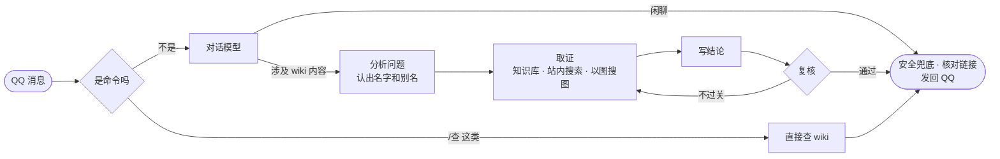

<div align="center">


<p>
  
  
  
  
</p>

<p>
  <a href="#快速开始">快速开始</a> ·
  <a href="#接上你自己的-wiki">接上你自己的 wiki</a> ·
  <a href="docs/架构.md">架构</a> ·
  <a href="docs/插件规范.md">插件规范</a> ·
  <a href="docs/部署与运维.md">部署与运维</a> ·
  <a href="docs/管理后台.md">管理后台</a>
</p>

</div>

## 见山是什么

群里总有人问「这个角色的技能是什么」「上次那个活动奖励有哪些」。答案 wiki 上都有，只是没人想去翻。

见山（JianShanAgent）是一个挂在 QQ 上的 wiki 问答机器人：你在群里 @ 它问一句，它去 wiki 上把答案找出来，
核对过再告诉你，后面附上出处。名字取自「开门见山」——不绕弯子，也不替 wiki 编答案。

它为 MediaWiki 而写。现在在线上服务的是[阴阳师 wiki](https://yys.huijiwiki.com)，换一个 wiki 不用改这个仓库的代码。

<sub>JianShanAgent is a QQ bot that answers questions from a MediaWiki site: direct lookups without an LLM, retrieval-augmented answers that pass a review step before being sent, reverse image search over the wiki's images, and an admin console. Site-specific behaviour lives in plugins. Documentation is in Chinese.</sub>

## 它有什么不一样

- **能直接查的，不麻烦大模型。** `/查 高铁` 这样的命令直接读 wiki 的数据，一两秒回来，不会编。
- **拿不准的，先查证再开口。** 自然语言的问题会先去知识库和站内搜索找资料，写完结论还要过一遍复核——
  资料里没有的不说，复核不过就打回重写。回答后面带着参考资料，链接只留确实查到过的。
- **认得图。** 发一张立绘、头像或者截图，它在 wiki 的图库里以图搜图，告诉你这是谁、哪个皮肤。
- **跟着 wiki 走。** 每小时看一眼 wiki 的最近更改，只重做变了的那部分。wiki 改了，它的答案也跟着改。
- **看得见它在想什么。** 自带一个网页后台：每条消息走了哪几步、各花了多久、看了哪些资料、复核怎么说，都查得到。
- **换一个 wiki 不用动核心。** 核心只懂 MediaWiki 和 QQ。某个平台、某个站特有的东西——数据接口、清洗规则、
  提示词里的说法、人设——都是插件，很多时候只要写一份配置。

## 聊起来是什么样

精确的命令不过大模型，直接查：

```text
你    /查 高铁
见山  【大天狗·高天铁羽】 · UR · 男 · CV 前野智昭（日）/ 郑武文杰（中）
      别名：高铁、UR狗、UR大天狗
      定位：伤害
      ……（技能、御魂搭配，最后是条目链接）

你    /筛选 SP 拉条
见山  SP + 拉条：共 7 个式神
      灼华桃花妖、纺愿缘结神、禅心云外镜、梦寻山兔、空相面灵气、聆海金鱼姬、稻荷神御馔津
```

随口问的，它会去查证，边查边告诉你进度：

```text
你    @见山 上次那个活动的奖励都有什么来着
见山  正在查资料、整理答案…
见山  正在复核…
见山  （结论：是哪一期活动、奖励有哪些，三百字以内）
      参考资料：
      1. <查到的页面标题和链接>
```

闲聊它也接得住，只是不会把闲聊当成事实去查。`/记忆`、`/清除记忆`、`/新话题` 让每个人管自己的对话历史和它记住的事。

（上面两条命令的回复是线上对真实 wiki 查出来的，`/筛选` 和式神、御魂的结构化回复来自阴阳师的站点插件。）

## 一条消息怎么走



细节见 [架构](docs/架构.md)。

## 快速开始

见山不是下载下来双击就能用的那种机器人，它需要几样外面的东西：

- 一个 **QQ 开放平台的机器人**（AppID 和密钥）；
- 一个 **OpenAI 兼容的对话模型**接口（目前按小米 MiMo 调通）；
- 一个 **嵌入接口**，要文字和图片都能算（目前用 `Qwen3-VL-Embedding-8B`），知识库检索和以图搜图靠它；
- **Postgres**（带 pgvector），部署工具会替你起好。

准备好以后：

**1. 建一个实例仓库。** 用模板 [`template-instance`](https://github.com/JianShanAgent/template-instance) 建一个你自己的仓库，
和这个仓库并排放在同一个目录下。它只有几个文件：服务哪个 wiki、用哪些插件的哪个版本、凭据的模板。

**2. 告诉它服务哪个 wiki。** 在实例的 `config/core.wiki.yaml` 里填上名字和接口地址：

```yaml
name: "某某"
api_url: "https://your.wiki/api.php"
```

**3. 先在本机不连 QQ 跑起来看看。**

```bash
cd instance-yours
cp config/secrets.example.yaml config/secrets.yaml     # 填 QQ、对话模型、嵌入接口的凭据
uv sync
JIANSHANAGENT_DRY_RUN=1 uv run jianshanagent             # 不连 QQ 试跑；在管理后台的网页对话里可以直接问它
```

**4. 部署到服务器。** 一台装了 Docker 的 Linux 服务器就够。在实例仓库里：

```bash
./release pin && git commit -am "第一次发布"
./release push                 # 打包上传、构建镜像
./release activate <发布号>     # 上线；起不来会自动切回上一个
```

第一次部署、回滚、备份恢复、知识库怎么导入，都在 [部署与运维](docs/部署与运维.md) 里。

> 同一个机器人不能两处同时在线，不然一条消息会被回复两次。线上的在跑时，本机只用 `JIANSHANAGENT_DRY_RUN=1`。

## 接上你自己的 wiki

按你想让它多懂这个站，分三档，越往后越省不了事，但也越好用：

| 你想要的 | 要做的 | 从哪开始 |
|---|---|---|
| 先跑起来。任何 MediaWiki 都行：`/查` 认页面标题和全文搜索，知识库收条目页 | 只填 wiki 的地址，不写插件 | [`template-instance`](https://github.com/JianShanAgent/template-instance) |
| 让它说这个站的话：去掉这个站的模板噪声、问题怎么分类、提示词里的说法、人设、昵称 | 写一个站点插件，多半只是一份配置 | [`template-site-wiki`](https://github.com/JianShanAgent/template-site-wiki) |
| 让它读这个站的结构化数据、有自己的命令；或者好几个站共用一个 wiki 平台 | 站点插件里写代码；平台共用的部分单独成一个平台插件 | [`template-site-platform`](https://github.com/JianShanAgent/template-site-platform) |

阴阳师 wiki 是走到第三档的例子：[`site-huiji`](https://github.com/JianShanAgent/site-huiji)（灰机平台）、
[`site-huiji-yys`](https://github.com/JianShanAgent/site-huiji-yys)（阴阳师 wiki）、
[`instance-yys`](https://github.com/JianShanAgent/instance-yys)（这个部署）。命名和写法的规矩在 [插件规范](docs/插件规范.md)。

## 管理后台

机器人自带一个网页后台，和它跑在同一个进程里：

- **查证过程**：每条消息走了哪几步、各步多久、看了哪些资料、复核说了什么——回答不对时，从这里看是哪一步出的问题；
- **网页对话**：不经过 QQ 直接问它，调提示词和人设时用；
- **配置和插件**：在网页上改配置、开关插件，马上生效，写错了自动撤回；
- **知识库**：收了多少、自动更新到哪了、检索和以图搜图试一试；
- 另有首页统计、模型调用、实时日志、用户与会话、群聊记录。

怎么打开、怎么登录见 [管理后台](docs/管理后台.md)。

## 这个仓库里有什么

```text
src/jianshanagent/
  core/        配置、消息、插件宿主、路由、模型和嵌入的调用、处理记录
  gateway/     QQ 接入
  plugins/     七个自带的功能插件：查询、知识库、查证、对话、记忆、群聊记录、安全兜底
  admin/       管理后台的接口（页面在 webui/）
  defaults/    默认配置
  testing/     写插件测试用的工具、插件规范自检
deploy/        Dockerfile、compose、发布脚本、备份；可拆的服务是部署插件（logs = 运行日志）
webui/         管理后台的页面（React）
docs/          文档
```

配置是分层的 YAML：默认值随代码走，站点插件往上补，每个部署只写和默认值不一样的地方，后台里还能再改。
细节在 `src/jianshanagent/core/config.py` 开头。

## 参与开发

```bash
uv sync --extra dev
uv run pytest
uv run ruff check . && uv run ruff format --check .
```

- 这里的测试是站在「一个不带站点插件的 MediaWiki」上跑的。查询和知识库管线的大部分测试是拿阴阳师 wiki 的数据写的，
  在 [`site-huiji-yys`](https://github.com/JianShanAgent/site-huiji-yys) 里——改了这两块，那边也跑一遍。
- Postgres 相关的测试默认跳过，设 `JIANSHANAGENT_TEST_POSTGRES_DSN`（指向一个测试库）后运行。
- 管理后台的页面：`cd webui && npm install && npm run build`。
- 对真实的 wiki 取数要守规矩：那是别人的站点，限速和并发不要调高。

发现问题、想接一个新的 wiki，欢迎提 issue。

## 文档

| | |
|---|---|
| [架构](docs/架构.md) | 核心里有什么、一条消息怎么走、数据放在哪、写代码时要知道的约束 |
| [插件规范](docs/插件规范.md) | 三种插件、怎么取名、清单怎么写、怎么让核心找到它 |
| [部署与运维](docs/部署与运维.md) | 发布、回滚、知识库自动更新、备份和恢复 |
| [管理后台](docs/管理后台.md) | 地址、登录、在网页上改配置 |

全部仓库的目录在[组织主页](https://github.com/JianShanAgent)。

## 许可

[MIT](LICENSE)
