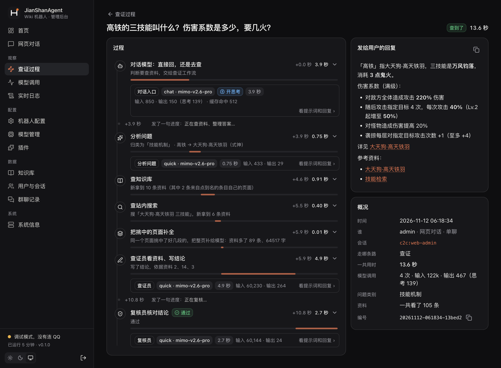
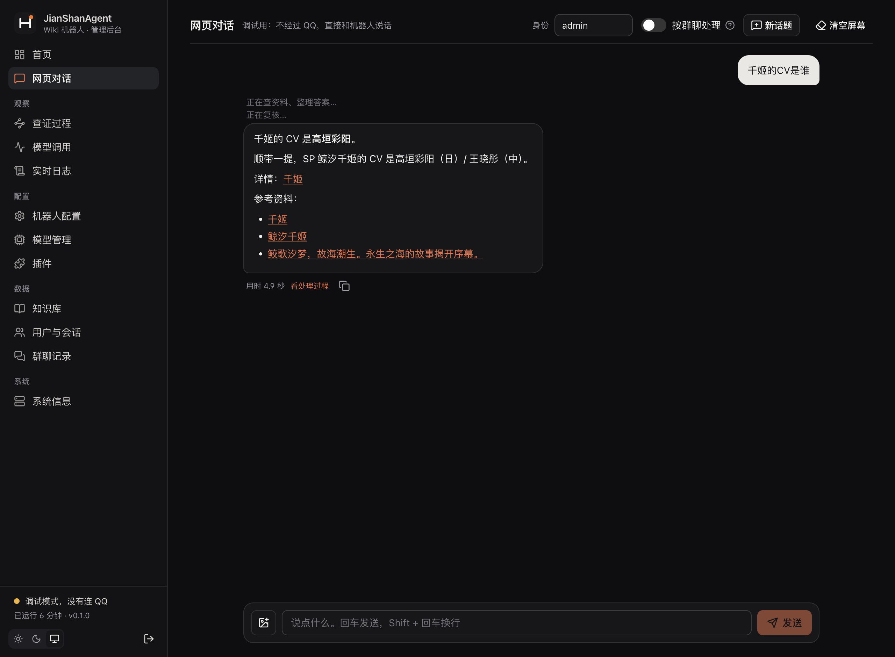
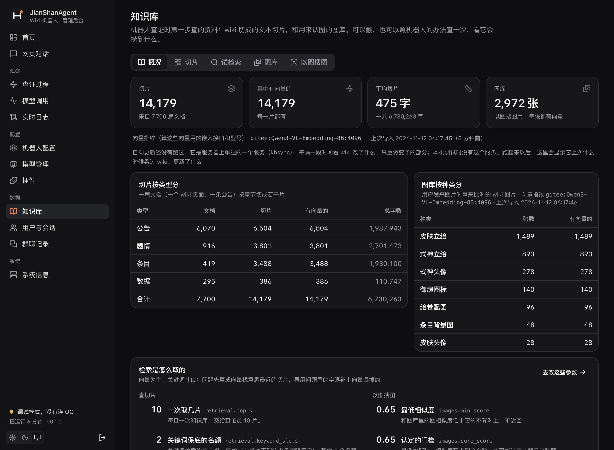
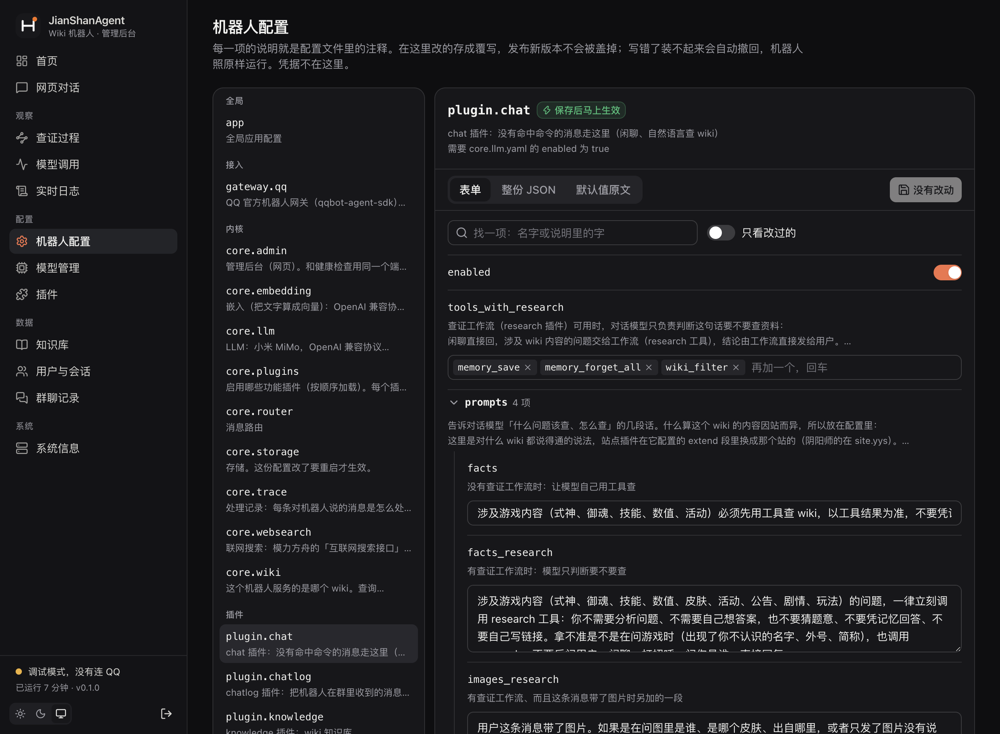
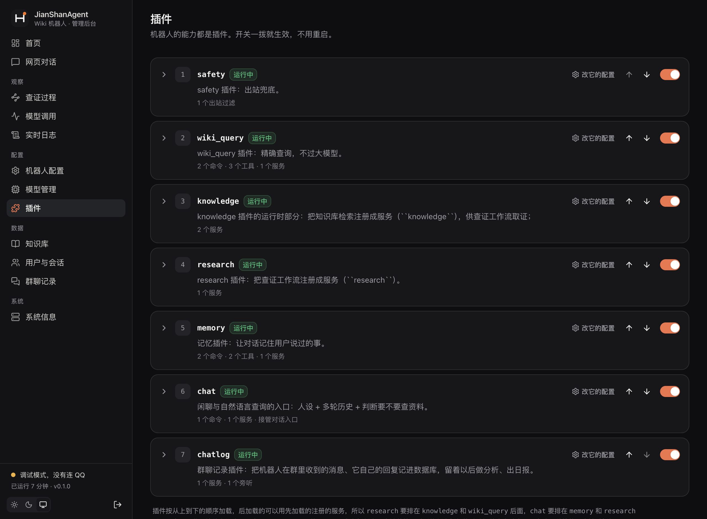

# 管理后台

> JianShanAgent · 核心 · 文档

浏览器里的工作台（前端静态资源已随 `agent-core` 预编译打包，无需额外安装 Node.js）：首页统计、查证过程（每条消息走了哪几步、各步多久、看了哪些资料、复核说了什么）、模型调用、实时日志、改配置和模型、插件启停、网页对话（不经过 QQ 直接问机器人）、知识库和以图搜图、用户与会话、群聊记录。

- **访问地址**：
  - Python 原生直跑或使用 `template-instance` 的 `docker compose`：默认 `http://127.0.0.1:8080`。
  - 使用 `./release` 生产发布栈：默认映射在服务器本机 `127.0.0.1:13001`；如需局域网打开，在服务器的 `/opt/jianshanagent/shared/.env` 里设置 `ADMIN_BIND_ADDR=<服务器内网IP>`（端口用 `ADMIN_PORT` 改），再执行 `/opt/jianshanagent/ctl up -d`。
- **登录令牌**：优先读取 `secrets.yaml` 的 `admin.token`；没填时第一次启动自动生成，默认保存在实例目录下的 `data/admin/token`（生产发布栈位于数据盘的 `/home/jianshanagent/bot/admin/token`）。登录一次有效期 30 天；点击「退出登录」会使此前签发的所有浏览器登录会话立即失效。
- **在网页上改的配置**存成覆写文件（默认保存在实例目录的 `data/config/<名字>.yaml`，容器内为 `/data/config/<名字>.yaml`，只记和默认值不一样的项），更新版本后依然保留；删掉某个文件即恢复默认。保存后马上热重载生效，写错了装不起来会自动撤回。`app`、`core.storage`、`gateway.qq`、`core.admin` 这四份需重启进程才生效，页面上有重启按钮。凭据不在网页上显示也不能在网页上改。
- **统计和查证过程**来自数据库的 `traces`、`llm_calls` 两张表；提示词和回复默认保留 14 天，处理记录保留 90 天（`core.trace.yaml`）。
- 「用户与会话」默认列出最近 30 天活跃记录，「群聊记录」默认最近 7 天。

## 几个常用的页面

下面的截图来自一个本机的调试实例（不连 QQ，接的是阴阳师 Wiki 的知识库），里面只有测试时问的几句话。

**查证过程**——一条提问是怎么处理的。左边按时间排着每一步：对话模型判断要不要查、分析问题（认出「高铁」是哪个式神）、查知识库、查站内搜索、把挑中的页面补全、查证员写结论、复核；每一步多久、拿到几条资料都写着，点开能看当时的提示词和模型的回复。右边是最后发给用户的回复，和这一条的概况（一共用时、调了几次模型、多少 token、看了多少资料）。回答不对时从这里找是哪一步出的问题。

<p align="center"></p>

**网页对话**——不经过 QQ 直接问机器人，走的是和 QQ 消息完全一样的处理流程。可以换身份、当成群聊消息处理、带图片；每条回复下面有「看处理过程」，直接跳到上面那一页。网页上的身份和 QQ 上的用户互不相干，这里发的消息不进群聊记录。

<p align="center"></p>

**知识库**——库里现在有多少切片和图片、各是什么类型、向量是哪个接口算的、自动更新上次什么时候看过 wiki。另外几个标签页可以翻切片、照机器人的办法试检索一次、传一张图试以图搜图。挂了几个 wiki 时，概况里每个 wiki 各列一行、各有一张自动更新的卡，切片和图可以按 wiki 筛，检索结果标着出自哪个 wiki。

<p align="center"></p>

**机器人配置**——左边是全部配置文件，右边按表单改，每一项下面的说明就是配置文件里的注释；也可以看整份 JSON 和默认值的原文。标着「保存后马上生效」的不用重启。有哪些配置、各管什么，见 [配置说明](配置说明.md)。

<p align="center"></p>

**插件**——启用了哪些、按什么顺序加载、每个注册了几个命令、工具、服务。开关一拨就生效。实例目录里自己写的功能插件（`plugins/<id>/`）也列在这里。

<p align="center"></p>

**系统信息**——进程、连接、配置目录、凭据填没填、数据库的表和备份，以及重新加载、重启。最上面是「版本与更新」：正在用哪个版本、主仓库最新是哪个，有新版本时点一下更新并重启（见 [部署与运维](部署与运维.md) 的「核心的更新」）。

## 本机启动与前端开发

```bash
# 1. 本机不连 QQ 试跑（管理后台已在 http://127.0.0.1:8080 就绪，无需构建前端）
JIANSHANAGENT_DRY_RUN=1 uv run jianshanagent

# 2. 仅当你修改了 agent-core/webui 下的前端源码时，才需要用 Node.js 联调或重新构建：
cd webui && npm ci
JIANSHANAGENT_ADMIN_API=http://127.0.0.1:8080 npm run dev   # 启动前端热更新开发服务器
npm run build                                               # 重新编译静态产物到 src/jianshanagent/admin/static/
```
